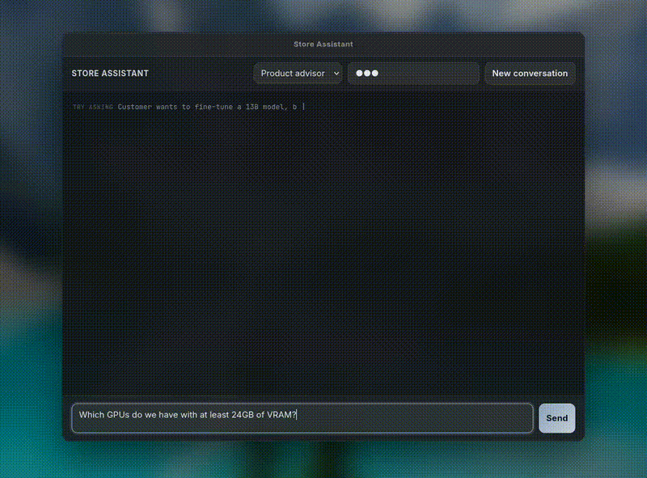
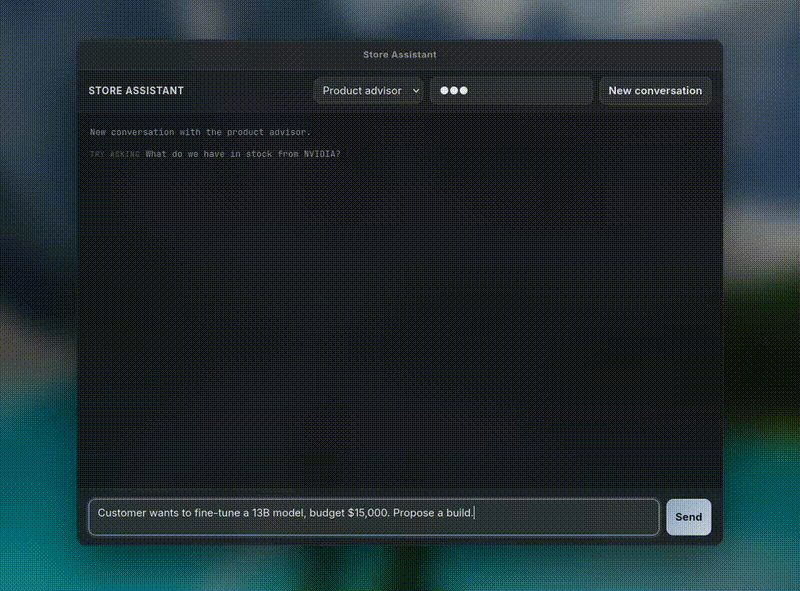
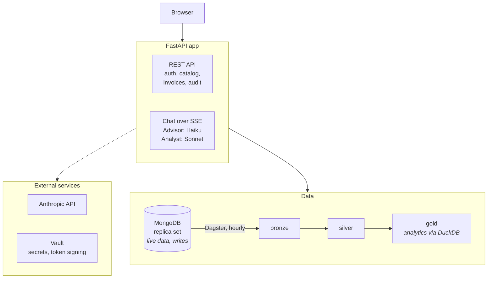

# Claude ERP Assistant

A FastAPI + MongoDB backend for a B2B hardware distributor (laptops, servers, GPUs, PC parts), with
two Claude assistants on top: an **Advisor** for consultants quoting products and an **Analyst** for
managers chasing payments. Both answer only from tool results. A data lake (bronze, silver, gold)
feeds the analyst so reporting queries stay off the operational database.


## Demo

The advisor quotes SKUs and list prices exactly as the catalog search returned them.



One `chart_invoices` call returns the rows and a PNG. USD and CAD are drawn on separate panels and
never summed.


The advisor estimates the GPU memory a workload needs and totals a setup from returned prices.



## What it does

* **Advisor** (Haiku 4.5): catalog search by category, brand, price and GPU specs; builds a setup
  within a budget. Model tool input goes through the same Pydantic validation as the HTTP API.
* **Analyst** (Sonnet 5): totals, open and overdue amounts, days to pay, rankings by customer,
  product, brand or category, per currency and period. Figures come from SQL over the gold layer,
  each answer states the filters used and how fresh the data is (`dataAsOf`).
* **Invoice close with approval**: the analyst can only request a close. The manager confirms the
  payment date on a card in the chat; the close, the request and an audit event are written in one
  transaction. Admins read the event history at `/audit`.
* **Web UI**: chat with a sidebar, invoice list for managers, product catalog, audit search for
  admins. Routes and sidebar items follow the role.
* **Auth**: argon2 passwords, short EdDSA access tokens signed in Vault, rotating refresh tokens
  (a replayed one revokes the whole session), per-account API keys for scripts. Roles are enforced
  in code, not in the prompt.

## Architecture



## Measured

| | |
|---|---|
| Invoices | 1,048,839 (48,839 real, the rest synthetic) |
| Analyst query, product/brand/category over full history | MongoDB 9.5–11.6 s (over the 5 s limit) → gold 0.43–0.53 s |
| Analyst query, other groupings, full history | MongoDB 1.5–1.9 s → gold 0.15–0.16 s |
| Analyst query, one quarter | MongoDB 0.07–0.24 s, gold 0.11–0.14 s |
| Lost confirmed writes when the primary is cut off | `w: 1`: 198 per run · `w: majority`: 0 |
| Full rebuild: bronze / silver / gold | 37 s / 38 s / 17 s |
| Gold vs MongoDB results | identical on 88 parity cases (8 groupings × 11 filters) |
| Tests | 1,030 unit/API + 185 integration, 99% branch coverage |
| Functional evals | 28/29 |

## Data lake

* **Bronze**: an hourly Dagster asset copies invoices whose `updatedAt` falls in the hour, read from
  a secondary with `readConcern: majority` so rolled-back writes never enter the lake. Raw Parquet,
  one partition per hour.
* **Silver**: latest version of each invoice, partitioned by posting month. Only touched months are
  rewritten. Invalid invoices go to quarantine, suspicious ones get flags, nothing is repaired.
  Customers get one canonical name (960 of 1,425 had several). A check compares per-month counts and
  cents with MongoDB, excluding invoices changed after the lake's watermark.
* **Gold**: star schema (`fact_invoice`, `fact_invoice_line`, customer, product and date
  dimensions), rebuilt on each run and published by rewriting one pointer file, so readers see a
  whole version or the previous one. Money is summed in whole cents.
* **Storage**: Garage locally, one bucket per layer; layer URIs and keys come from configuration,
  so the same code targets AWS S3. The analytics key can only read gold.

## Running it

```bash
./run.sh                                          # MongoDB replica set + API on :8000
PYTHONPATH=src:. dagster dev -m lake.definitions  # lake assets and checks
./venv/bin/python -m pytest                       # unit + API
./venv/bin/python -m pytest -m integration        # needs MONGO_TEST_URI
python evals/run.py --level functional            # live model, costs tokens
```

One-time setup scripts are in `deploy/` (replica set, users, Vault, Garage). `CLAUDE.md` lists every
command and environment variable.

## Tests and evals

CI runs unit, integration (MongoDB replica set), Vault and Docker image jobs on every push and
fails under 85% branch coverage. Evals run against the live model and check the tool calls and
the figures in the answer: re-run the model's queries, compare every SKU and price with the catalog,
require off-topic requests to be refused without tool calls. They cost tokens, so they are not in CI.

## Data

No real company data. 48,839 invoices come from a Kaggle accounts-receivable dataset (USD and CAD,
2018–2020). A generator adds about a million synthetic invoices from 2018 to today, each based on a
random real one and marked `source: "synthetic"`. The 97-product catalog was generated with an LLM;
invoice lines are generated against it and add up to each invoice total.

## Stack

| | |
|---|---|
| API | Python 3.14 · FastAPI 0.141 · Pydantic 2 · SSE |
| AI | Anthropic SDK 1.6 · Claude Sonnet 5 · Claude Haiku 4.5 |
| Database | MongoDB 7 replica set · PyMongo |
| Lake | Dagster · pyarrow · Garage (S3) · DuckDB |
| Auth | argon2 · PyJWT (EdDSA) · HashiCorp Vault |
| Tests, CI | pytest · GitHub Actions · Docker Compose |

## Next

* Scheduled bronze → silver → gold runs, so gold is at most an hour behind MongoDB.
* Speech to text in the chat (self-hosted Whisper), with the transcript reviewed before sending.
* Chat history in the sidebar.
