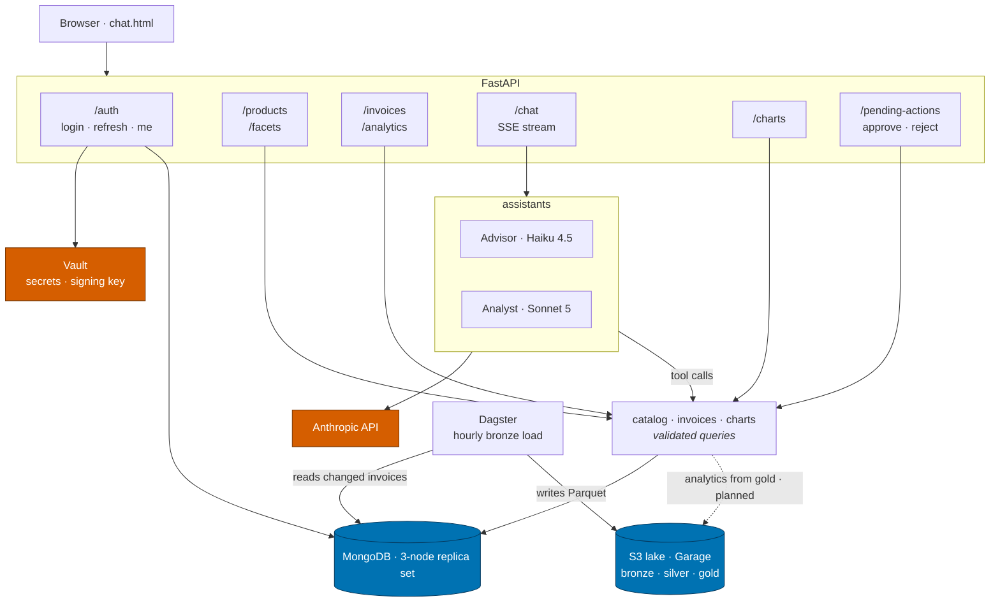

# Claude ERP Assistant

## The problem

A B2B distributor sells laptops, servers, data center gear and PC parts to large companies. It
needs one system to keep track of what it sells and who owes it money. Two groups of staff have to
get answers from it quickly: consultants quoting hardware to a customer on the phone, and managers
chasing payments and planning cash flow. Neither group writes SQL, a wrong price or a made-up
figure costs real money, and the invoice history keeps growing.

## What this is

A small ERP slice that answers in plain language and never guesses. A REST API over MongoDB holds
the catalog and the receivables, and two Claude assistants sit on top of it:

* the **Advisor** (Haiku 4.5) finds products, checks specs and builds setups within a budget,
  quoting only SKUs and prices it has just retrieved;
* the **Analyst** (Sonnet 5) answers finance questions with figures computed by the database,
  draws charts, and can ask a manager to close an invoice.

A data lake is being built next to it, so heavy analytics stop competing with daily operations.

Built while working toward the **Claude Certified Developer** certification. The domain is a
vehicle; the point was tool use, prompt caching, streaming, evals and a real error taxonomy
instead of a toy chat wrapper.

## Demo

The advisor searches the catalog and quotes SKUs and list prices exactly as returned, never
naming a product it did not just retrieve.


One `chart_invoices` call returns the rows *and* a rendered PNG, so the answer carries a table and
a picture. USD and CAD get separate panels on separate scales; they are never added or compared.


The advisor estimates the memory a workload needs, states the estimate, then proposes a
configuration inside the budget and totals it from returned prices.


## Architecture



## Features

* **Grounded product advice.** Search by category, brand, budget and GPU specs (memory, FP16
  throughput, multi-GPU scaling). The advisor sizes a workload, proposes a setup and totals it from
  catalog prices; every model request goes through the same validation as the HTTP API.
* **Invoice analytics in plain language.** Totals, open and overdue amounts, days to pay and
  rankings by customer, product, brand or category, per currency, over any period. The numbers
  come from the database, never from the model, and every answer states the filters it applied.
* **Charts from the same query.** Trends and rankings are rendered on the server from the rows the
  analyst just retrieved, so the picture and the table can't disagree.
* **Human-approved actions.** The analyst can only *request* an invoice close; the manager approves
  or rejects it in the chat, and only then does the invoice change.
* **Accounts, roles and API keys.** Consultants see the catalog and the advisor, managers also the
  invoices and the analyst. Sessions rotate their tokens and end when a stolen one is replayed;
  scripts use per-account API keys. Authorization lives in code, not in the prompt.
* **Secrets in Vault.** App secrets come from Vault, and access tokens are signed by a key that
  never leaves it and rotates without logging anyone out.
* **Conversations that survive restarts.** Chats are stored per user and assistant and expire on
  their own.
* **No lost confirmations.** Three database nodes; a confirmed write survives the loss of the
  primary. Measured, not assumed: see the data lake section.

## Quality

Every push and pull request runs CI, and the build fails on a failing test or on branch coverage
under 85%, so shortcuts don't pile up as tech debt. Tests come in layers:

* **Unit and API tests** on hand-written fakes, e.g. a route × role matrix that proves a consultant
  can't reach invoices, and the rule that a `tool_use` cut off by `max_tokens` is never executed.
* **Integration tests** against a real MongoDB, Vault and S3 store, e.g. query plans that must use
  their index, signing-key rotation, and the lake's read-only key being refused everything but gold.
* **Evals** against the live model, because passing tests say nothing about how the model behaves.
  Graders re-run the model's own queries, check every SKU and price in the answer against the
  catalog (this is what catches a hallucinated product that reads perfectly), check the analyst
  stated the figure the database produced, and require off-topic requests to be refused with no
  tool calls. A `functional` level grades the first model call, `e2e` drives the full chat flow.

```bash
python evals/run.py [--level functional|e2e|all] [--case ID]
```

Evals cost tokens, so they stay out of CI and are run deliberately.

## Data lake

With a million invoices, all-time rankings by category or product take longer than the 5 s limit
on database queries. The operational database should serve customers and approvals, not scans, so
analytics is moving to a lake fed from it:

* **Source.** A 3-node MongoDB replica set with majority writes. A lab script cuts nodes off the
  network and counts what survives: with single-node acknowledgement a cut-off primary confirmed
  ~200 orders that were then rolled back; with majority, none.
* **Bronze** (running). An hourly Dagster asset copies every invoice changed in that hour, read from
  a secondary with majority read concern so a rolled-back write never lands in the lake. Each run
  checks its partition against the database count and the expected schema. The first load moved
  all 1,048,839 invoices in under 40 s and matched the database to the cent.
* **Silver and gold** (next). One clean version per invoice, then a dimensional model that the
  invoice analytics will query instead of MongoDB.
* **Portable storage.** Garage serves S3 locally; each layer is a URI, so the same code runs on AWS
  S3 by changing configuration. The analytics key can only read gold.

## Tech stack

| | |
|---|---|
| Language | Python 3.14 |
| API | FastAPI 0.141 · Pydantic 2 · Uvicorn · SSE |
| Database | MongoDB 7, 3-node replica set · PyMongo 4.18 |
| AI | Anthropic SDK 1.6 · Claude Sonnet 5 · Claude Haiku 4.5 |
| Data lake | Dagster 1.13 · pyarrow (Parquet) · fsspec / s3fs · Garage v2 (S3) |
| Charts | Matplotlib (Agg backend) |
| Auth | argon2 · PyJWT (EdDSA) · HashiCorp Vault 1.20 via hvac |
| Data prep | pandas |
| Tests, CI | pytest · branch coverage · GitHub Actions |
| Infra | Docker Compose |

## Data

Nothing here is proprietary or real. The 48,839 base invoices come from an accounts receivable
dataset on **Kaggle** (USD and CAD, 2018–2020). On top of them a generator adds a million
**synthetic** invoices from 2018 to today, each modelled on a random real one (customer, currency,
payment terms and delay) and marked `source: "synthetic"`. The 97-product catalog of laptops,
servers, UPS units, rack gear and components was **generated with an LLM**; invoice line items are
synthesised against it and reconcile to each invoice's total.

## In development

* **Silver, gold and analytics on gold**, with the age of the data stated in every answer.
* **Automatic model routing**: cheap lookups on Haiku, escalation to Sonnet only when a question
  needs it, without a conversation ever changing model halfway through.
* **Warranty and spec RAG** over manuals and warranty terms, still grounded in a retrieved source.
* **Account admin panel**; accounts and API keys are managed from the command line for now.
